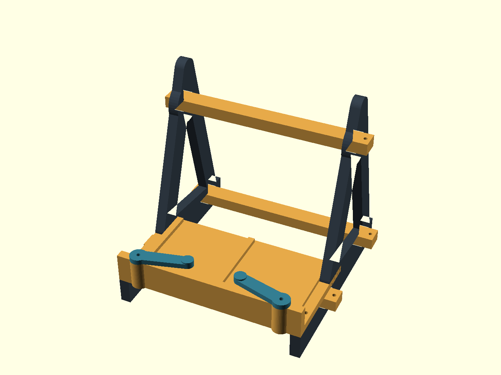
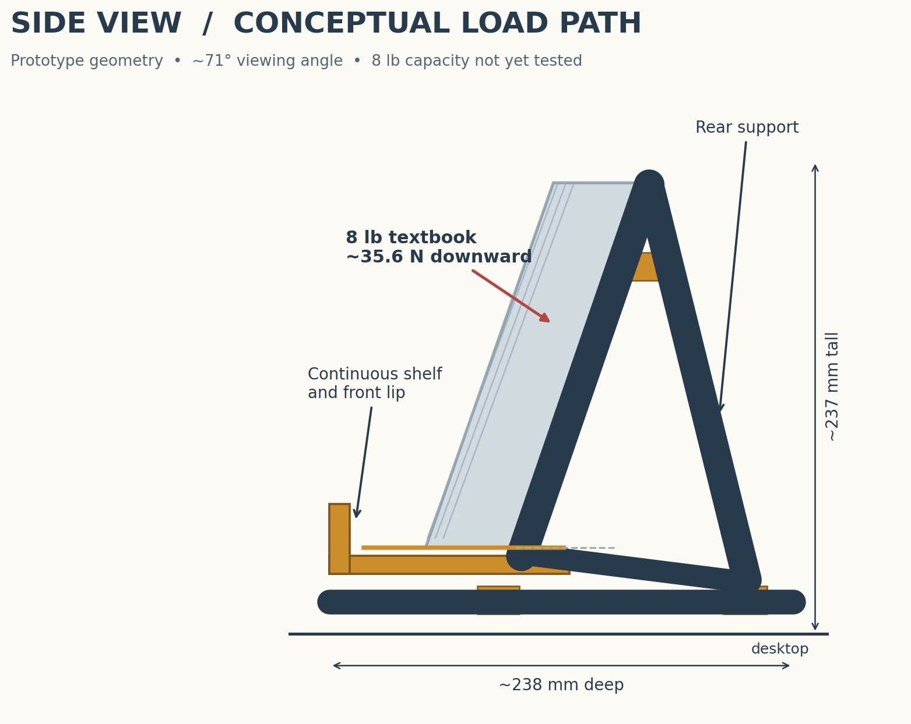

# Heavy-Duty Ergonomic Textbook Stand

**An editable, 3D-printable desktop book stand designed around an 8 lb textbook.** This is an **early prototype: the 8 lb load target has NOT yet been physically verified.**

## The problem

Reading thick textbooks flat on a desk can mean long periods looking downward. I wanted to bring the pages closer to an upright reading position while keeping a heavy book supported and making it possible to turn pages without holding them open continuously.

## Engineering objectives

| Requirement | Design response | Verification status |
| --- | --- | --- |
| Support an 8 lb (3.63 kg) textbook | Triangulated A-frame sides, two low tie bars, an upper tie bar, continuous shelf | **Not load-tested** |
| Comfortable reading angle | Fixed backrest about **71° above the desktop** | CAD geometry only |
| Hold pages open | Independently pivoting page-retaining arms near lower corners | **Fit and usability test pending** |
| Print on a Creality K2 | Largest individual STL is 246 mm long; standard K2 capacity is 260 × 260 × 260 mm | STL dimensions checked |
| Easy modification | Editable OpenSCAD CAD with configurable key dimensions; parts exported separately | Source and STLs provided |
| Reduce sliding | Front shelf lip and planned non-slip feet | Foot pads not included |

## Prototype design

The stand uses **two side frames**, a **full-width book shelf**, **three cross rails**, and **two movable page holders**. Its rearward-sloping supports create a near-vertical reading surface. The wide bottom footprint and triangulated side brackets are intended to improve stability compared with a simple folding display easel.

**Nominal assembled geometry** (excluding bolt heads and the book): approximately 246 mm maximum width across tie bars, 238 mm deep, and 237 mm high. Each part fits on the standard K2 bed. The rest angle is fixed in prototype v0.1; an adjustable-angle mechanism is a planned improvement, not an existing feature.

The shelf can physically accommodate a thick spine between its lip and lower back support, but maximum book thickness, book height, clamp fit, and page-turning performance require measurement and testing against the specific textbook. A textbook wider than the frame must be centered and tested for lateral stability.

## Preview and files

- [`cad/textbook_stand.scad`](cad/textbook_stand.scad): editable CAD source with configurable dimensions.
- [`stl/`](stl/): ready-to-import printable STL parts.
- [`docs/assembly.md`](docs/assembly.md): hardware list and assembly procedure.
- [`docs/design_notes.md`](docs/design_notes.md): requirements, calculations, technical choices, and limitations.
- [`docs/load_test.md`](docs/load_test.md): load, stability, page-holding, and iteration tests. **No actual results are claimed.**
- [`build_stls.sh`](build_stls.sh): repeatable STL export on a machine with OpenSCAD.

### Printable part quantities

| STL | Quantity |
| --- | ---: |
| `side_frame.stl` | 2 |
| `shelf.stl` | 1 |
| `front_rail.stl` | 1 |
| `rear_rail.stl` | 1 |
| `upper_rail.stl` | 1 |
| `arm_left.stl` | 1 |
| `arm_right.stl` | 1 |

All files are provided as individual STLs, not just a compressed archive. The side frames are identical and only require one STL.

## Printing

- Printer: **Creality K2**, 0.4 mm nozzle or similar.
- Material: **PETG preferred** for the structural parts; PLA/PLA+ may be used for preliminary fit prototypes, but avoid hot cars or other heat exposure. Check your filament manufacturer's parameters.
- Starting slicer configuration to experiment with: **0.20 mm layers; 5 to 6 walls; 5 to 7 top/bottom layers; 35 to 45% gyroid infill; 6 to 8 walls around holes or load-bearing mounting points as needed.** These are prototype starting points, not an independently validated strength rating.
- Print the side frames flat with the large profile face on the bed, the shelf with its flat underside on the bed, and the rails and arms flat. Inspect preview for unexpected unsupported sections.
- With a 246 mm rail on a 260 mm plate, check that any brim fits; do not automatically add an oversized brim.
- Add stick-on rubber/silicone pads to both frame feet to reduce tabletop sliding.

More detailed instructions are in [docs/assembly.md](docs/assembly.md).

## First-order load calculation

Convert the target book weight into force:

\[
 m = 8\text{ lb}\times \frac{0.453592\text{ kg}}{1\text{ lb}} \approx 3.63\text{ kg}
\]

\[
 F_g = mg = (3.63\text{ kg})(9.81\text{ m/s}^2) \approx 35.6\text{ N}
\]

That is the approximate static downward gravitational force of the textbook, **not** a safety factor or the force on any individual printed joint. Printing orientation, material strength, shelf bending, fastener clamping, and tip resistance need physical tests. See [docs/design_notes.md](docs/design_notes.md).

## Validation and documentation plan

1. Check every part for interference, measure screw-hole clearances, and photograph the assembled stand.
2. Progressively test centered book loads of **2, 4, 6, and 8 lb** over a protected surface. Record deflection and any cracking, creaking, or sliding. Stop at the first sign of damage.
3. Evaluate opening and turning pages, with different left/right page thicknesses and real textbook dimensions.
4. Check front, back, and lateral tipping when turning pages and applying small realistic hand forces.
5. Record before/after CAD changes, print orientation, filament settings, material usage, and actual findings with images and short videos.

Until the tests pass, the design should be labeled **prototype, unverified for 8 lb**. Do not leave an untested loaded stand unattended or use it near fragile equipment.

## Roadmap

- [x] Define the user problem and target design constraints
- [x] Make the first editable CAD model
- [x] Export individual STL files and check their mesh integrity/bounding boxes
- [ ] Print v0.1 on Creality K2
- [ ] Assemble and test with actual 8 lb textbook
- [ ] Improve page-holder gripping force and clearance
- [ ] Measure deflection and adjust structural walls or geometry
- [ ] Explore adjustable viewing angle in v0.2
- [ ] Add real photos, load-test videos, iteration data, and a short demonstration

## Tools

OpenSCAD, Creality K2, PETG, STL mesh checking, and GitHub for version control and documentation.

**References:** [Creality K2 build volume and material specifications](https://www.creality.com/products/k2-series-3d-printer), [Prusa: modeling with 3D printing in mind](https://help.prusa3d.com/article/modeling-with-3d-printing-in-mind_164135?product=core-one-l-plus).

## License

MIT. See [LICENSE](LICENSE).
